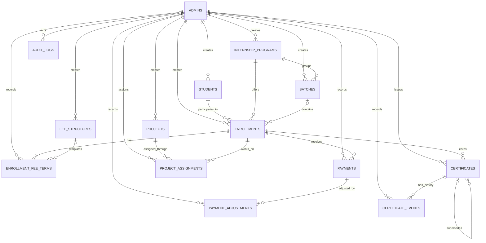

# Database Design

## Prabha Technology Pvt. Ltd. Internship Management System

| Document field | Value |
| --- | --- |
| Version | 0.1 Draft for approval |
| Baseline | SRS v0.1 and `docs/02-sprint-plan.md` |
| Target database | PostgreSQL 14 or later |
| Currency | INR only in this MVP design |
| Status | Presented for database-design approval |

This document remains the original PostgreSQL design draft; it is not the active schema specification. The application currently uses MySQL and Alembic, and `database/schema.sql` is not executable against that database. The MySQL ORM and Alembic revisions are authoritative for the running application.

### Current MySQL implementation overlay

The forward-only Alembic revision `0009` is implemented in code but has **not** been applied to the shared database. After it is separately approved and applied, the active application behavior is:

- Student, program, batch, enrollment, project, and certificate business numbers are generated transactionally using `business_number_counters`. Formats are `STU-YYYY-000001`, `PRG-YYYY-0001`, `BAT-YYYY-0001`, `ENR-YYYY-000001`, `PRJ-YYYY-0001`, and `CERT-YYYY-000001` (`YYYY` is the UTC calendar year). Legacy values are preserved.
- Students have nullable `address`, `city`, `state`, `postal_code`, `institution_name`, `course`, and `internship_domain` profile fields.
- Programs have a positive `duration_months` for new/updated records. Historical values remain null until an Admin supplies them.
- Batch codes are unique across programs. Every enrollment must reference a batch belonging to its program; the create API accepts `student_id` and `batch_id` and derives `program_id`.
- Before changing the schema, the revision checks for enrollments without a batch, missing or mismatched batch/program links, and duplicate batch codes. It stops with an explicit error instead of guessing how to repair those records.

The sections below retain the proposed PostgreSQL logical/physical design for historical context and must not be treated as an exact description of the current MySQL schema.

## 1. Design Goals and Principles

- Preserve a student's multiple enrollment records independently over time.
- Tie the fee, every receipt, project assignment, and certificate to the correct enrollment.
- Keep money in exact `NUMERIC` values and derive balances/statuses instead of storing stale totals.
- Represent refunds, reversals, fee changes, certificate replacement, and revocation as traceable append-only events.
- Enforce referential integrity, non-negative balances, duplicate protection, and concurrency-safe overpayment prevention at the database boundary where practical.
- Archive master records rather than deleting records referenced by history.
- Minimize personal data and keep secrets out of the database design except for password hashes if local authentication is selected.
- Use Alembic migrations for application releases; `schema.sql` is a reviewable design/bootstrap artifact, not a replacement for migration history.

## 2. Conceptual Design

### 2.1 Main concepts

- An **Admin** creates and manages records. Admin is the only application role in this release.
- A **Student** can have zero or many **Enrollments** over time.
- An **Internship Program** has zero or many **Batches** and zero or many **Enrollments**.
- An **Enrollment** represents one student's participation in one program and optionally one batch. Its fee terms and operational history are specific to that enrollment.
- A **Fee Structure** is a reusable program-level template. Each enrollment receives one or more historical **Enrollment Fee Terms**; the agreed amount is snapshotted so later template edits do not change an existing agreement.
- A **Payment** is a posted receipt attached to exactly one enrollment. A **Payment Adjustment** records a refund or reversal against one receipt; the original receipt is never edited away.
- A **Project** can be assigned to one or more enrollments through **Project Assignments**, enabling both individual and cohort/team project tracking without duplicating project details.
- A **Certificate** is an issuance record for one enrollment. **Certificate Events** preserve replacement, revocation, and correction history.
- **Audit Logs** record administrative/security actions. Domain-specific payment and certificate events remain authoritative for their respective histories.

### 2.2 Mermaid ER diagram



`AUDIT_LOGS.actor_admin_id` is nullable to record events such as unauthenticated/denied access attempts, where there is no authenticated Admin actor. The audit target is polymorphic (`target_type`, `target_id`) and therefore does not have a foreign key to every business table; audit payloads must not be treated as the authoritative business record.

## 3. Logical Design

### 3.1 Tables and responsibilities

| Table | Key attributes and relationships | Rationale |
| --- | --- | --- |
| `admins` | `admin_id` PK; unique normalized `username`; optional unique email; `password_hash`; active flag; `auth_version`; timestamps | One role type means no role lookup table is needed. `auth_version` revokes previously issued JWTs during password reset. Deactivate accounts; never cascade-delete actor history. |
| `admin_login_throttles` | HMAC hash of client address PK; failure count/window; block expiry; update time | Shared PostgreSQL rate-limit buckets coordinate across API workers without storing raw IP addresses; expired buckets are pruned. |
| `students` | `student_id` PK; unique `student_number`; name/contact fields; active/archived state; creator and timestamps | Holds only profile data. Student details are not copied into enrollments or payments. |
| `internship_programs` | `program_id` PK; unique code; name/description; draft/active/inactive state | Program definition is independent from its cohorts and enrollments. |
| `batches` | `batch_id` PK; `program_id` FK; code unique within program; name/date range; optional capacity; status | Composite unique `(batch_id, program_id)` supports a composite FK from enrollment, preventing a batch from another program being selected. Null capacity means unlimited; active enrollments consume capacity. |
| `enrollments` | `enrollment_id` PK; unique enrollment number; `student_id`, `program_id`, optional `batch_id`; dates/status | A repeat enrollment creates a new row. Historical enrollments are not overwritten or collapsed. |
| `fee_structures` | `fee_structure_id` PK; `program_id` FK; name; template amount/currency; active flag | Reusable default/template only. Editing it cannot change the agreed amount already recorded for an enrollment. |
| `enrollment_fee_terms` | `fee_term_id` PK; `enrollment_id` FK; optional template FK; agreed amount/currency; effective interval; reason/actor | Stores enrollment-specific fee history. One current term per enrollment; prior terms remain queryable. |
| `fee_adjustments` | `fee_adjustment_id` PK; enrollment FK; discount/fee-increase kind; positive exact amount; reason; approving Admin; UUID idempotency key | Append-only approved adjustments change the effective fee without overwriting the agreed fee term. Row locks and DB triggers prevent discounts below net paid. |
| `payments` | `payment_id` PK; one `enrollment_id` FK; positive receipt amount/currency; paid time/method/reference; UUID idempotency key; recording Admin | A row represents an accepted/posted receipt, not a pending or failed attempt. Receipts are immutable and duplicate requests map to the original receipt. |
| `payment_adjustments` | `adjustment_id` PK; `payment_id` FK; refund/reversal kind; positive amount; UUID idempotency key; reason/time/actor | Append-only financial corrections. A trigger ensures cumulative adjustments cannot exceed the receipt; a reversal must reverse its remaining amount. |
| `projects` | `project_id` PK; unique code; project description and lifecycle state | Stores reusable project definition once. Progress for a student's enrollment is on its assignment. |
| `project_assignments` | `project_assignment_id` PK; project/enrollment FKs; assignment status and dates; assigning Admin | Normalized many-to-many link supports team projects and more than one project per enrollment. Unique project/enrollment pair prevents duplicate assignment. |
| `certificates` | `certificate_id` PK; `enrollment_id` FK; unique number/type/issue data; optional internal document URI; optional self-FK to replaced certificate; issuer | Each row is one issuance. A replacement is a new row, preserving the prior issuance. Student is derived through enrollment rather than stored twice. |
| `certificate_events` | `certificate_event_id` PK; certificate FK; event type; optional related certificate; reason/time/actor | Append-only replacement, revocation, and correction history. Terminal state is derived, not overwritten on the issuance row. |
| `audit_logs` | `audit_log_id` PK; nullable Admin FK; action/target/outcome/time/request ID; allowlisted `jsonb` metadata | Cross-cutting actor/activity record. It is append-only to the application role; retention is policy controlled. |

### 3.2 Cardinality and duplicate-enrollment policy

- Student `1 : 0..N` enrollments; program `1 : 0..N` enrollments and batches; batch `0..1 : 0..N` enrollments.
- Enrollment `1 : 1..N` fee terms over its lifetime, with exactly one current term required at transaction commit by a deferred constraint trigger.
- Enrollment `1 : 0..N` receipts; receipt `1 : 0..N` adjustments.
- Enrollment and project are many-to-many through project assignments.
- Enrollment `1 : 0..N` certificate issuance records; a certificate `1 : 0..N` lifecycle events.
- Partial unique index prevents two `active` enrollments for the same student/program/batch tuple. A completed/withdrawn/cancelled enrollment can be repeated later. Simultaneous enrollments in different batches remain possible under this provisional rule; G0-03 must approve or change it.
- Optional batch capacity is an additive requirement from Sprint 4 API implementation; it was not present in the original table baseline. A nullable positive integer is enforced in the new migration. Only active enrollments count; capacity is checked under a row lock on the batch to serialize concurrent admission requests.

The index normalizes a `NULL` batch to an impossible identity value (`0`) only for uniqueness comparison, since generated identity values are positive. It does not store that sentinel in the row.

### 3.3 Normalization

The model is normalized to approximately third normal form: student, program, batch, project, and Admin facts are stored once; relationship-specific facts live on enrollments, project assignments, and certificate/payment event tables. Payment method and certificate status are not duplicated as mutable lookup snapshots.

Two deliberate historical facts are stored as snapshots: `enrollment_fee_terms.agreed_amount` and certificate issuance data. A fee template can change later, but a signed/agreed enrollment fee must not. A new fee term is inserted instead of editing the previous amount. Similarly, replacing a certificate creates a new issuance and a link/event rather than rewriting the old number/date.

`audit_logs.metadata` is `jsonb` because audit actions have a small, variable allowlisted context. It is not a place for whole student records, credentials, payment details, or arbitrary request bodies.

## 4. Physical Design: PostgreSQL

### 4.1 Types, keys, and constraints

- Surrogate keys use `bigint GENERATED ALWAYS AS IDENTITY`; public/business identifiers use separate unique text columns.
- Admin `auth_version` is a non-negative integer included in each signed access token and compared on every protected request. Password reset increments it, invalidating all outstanding tokens without persisting session tokens.
- Login throttle keys are HMAC-SHA256 values made with the configured application secret; raw client addresses are not stored. PostgreSQL row locking serializes attempts for the same key across workers, and stale throttle rows are removed after the greater of one day or the configured window-plus-block duration.
- Timestamps use `timestamptz`; date-only program/batch/enrollment boundaries use `date`. Reporting timezone must be selected at deployment.
- All monetary columns use `numeric(14,2)` and currency is checked as `INR`. The amount range/precision is an assumption to approve; never map values to binary floating point in application code.
- Statuses use `text` plus `CHECK` constraints in this baseline, allowing controlled status evolution through reviewed migrations without PostgreSQL enum migration friction.
- Foreign keys use `ON DELETE RESTRICT`. Historical or referenced rows must be archived/deactivated or corrected through an explicit, auditable flow; cascading deletion is not used.
- `enrollments` has a composite `(batch_id, program_id)` FK to `batches(batch_id, program_id)`, preventing an enrollment from referencing a batch belonging to another program.
- Batch capacity is null for unlimited intake or a positive integer. The API locks the batch row before checking active enrollment count; capacity reductions below the current active count are rejected.
- Key status/date/amount constraints are in `database/schema.sql`; application validation should provide good error messages but does not replace them.

### 4.2 Derived payment statuses and balances

`payments` contains only posted receipts. Failed or pending attempts are not financial receipts and are outside the MVP model unless policy requires a separate payment-attempt table. Status is derived in `v_payment_status`:

- `posted`: no adjustments.
- `partially_refunded`: refunds exist but the original receipt is not fully refunded.
- `refunded`: refund adjustments equal the receipt amount.
- `reversed`: a reversal event exists for the remaining receipt amount; the receipt is fully neutralized.

`v_enrollment_balances` derives `effective_fee = agreed fee + fee increases - approved discounts`, `net_paid = receipts - refunds/reversals`, and `pending_balance = GREATEST(effective_fee - net_paid, 0)`. The balance is not stored, so it cannot become stale after a correction. Receipt, fee-adjustment, fee-term, and refund/reversal writes serialize on the parent enrollment row; idempotency UUIDs prevent retries from applying a ledger event twice. DB triggers independently reject overpayment, discounts below net paid, and refunds beyond a receipt.

The deferred fee-term check requires a current term both when an enrollment is created and after a current term is closed or replaced. The trigger also rejects a new fee term below the enrollment's net receipts. A fee decrease below paid-to-date is therefore blocked; a refund, waiver, credit balance, or authorized overpayment requires an explicit policy/model extension. Database superusers can bypass application safeguards; production roles must not be superusers or table owners.

### 4.3 Index strategy

The DDL includes indexes for common lookup paths and foreign-key joins:

- Unique indexes: normalized Admin/student email when present, student/program/batch/business codes, certificate number, method/reference, one current fee term, one active enrollment tuple, one reversal per receipt, and one terminal certificate event.
- Lists: student lowercased name/status, program status/name, batch program/status/date, enrollment by student/program/batch/status, payment by enrollment/date, project assignment by enrollment/status, certificates by enrollment/issue date, audit by actor/target/time.
- Search is initially case-insensitive exact/prefix-friendly on indexed lowercased fields; broad substring/fuzzy search may require `pg_trgm` or a dedicated search service after workload testing. Do not add an extension or GIN index until search semantics and volume are approved.
- Validate index selectivity and query plans against a representative dataset before treating the proposed indexes as final. Avoid indexes on every mutable status field by default.

### 4.4 Deletion, history, and retention

- Students, programs, batches, fee structures, projects, and Admins are deactivated/archived; referenced rows are not physically deleted through normal application workflows.
- Enrollments are retained in terminal states. A corrected enrollment is handled through an approved auditable workflow, not row deletion.
- Payments, payment adjustments, fee terms, certificates, certificate events, and audit logs are append-only to the application role. DDL triggers reject update/delete for immutable event tables; fee terms permit only closing an open effective interval.
- A controlled legal-retention process may require anonymizing student contact fields while preserving financial/issuance records. Retention periods, legal holds, backup expiration, and any DBA-level audit purge must be approved and documented. The immutable trigger is not a substitute for a retention policy.
- `document_uri` must be a private object-store key or internal reference, not a public bearer URL. Access checks and signed-link lifetimes belong to the application/hosting design.

### 4.5 Security and privacy safeguards

- `admins.password_hash` stores only an adaptive password hash if local authentication is selected. Never seed production credentials or store plaintext/reversible passwords.
- Use separate migration-owner and application database roles. The application role must not own tables, be a superuser, or have `UPDATE/DELETE` permission on immutable financial/certificate/audit tables. Grant only required `SELECT/INSERT` and narrowly scoped update privileges for mutable records/current-term closure.
- Restrict direct audit access; use an allowlist for `metadata`, avoiding student PII and credentials. Record access/export events without copying full sensitive rows into logs.
- Use TLS for connections and encryption at rest/backup per hosting policy. Keep database credentials in a secret manager/environment injection, not SQL files or source control.
- Collect only approved student fields. This baseline uses student number, name, optional email, and optional phone; date of birth, address, government identifiers, and document contents are intentionally omitted pending privacy approval.
- Backups inherit the source database's sensitive-data classification. Encrypt, restrict access, define retention/RPO/RTO, and test restoration to an isolated environment.

## 5. Integrity Safeguards and Transaction Boundaries

### 5.1 Enrollment and fee creation

Create an enrollment and its first fee term in one database transaction. A deferred constraint trigger rejects commit if the enrollment has no current fee term. The initial term amount is copied from the selected fee structure (or entered as an approved agreed amount) and remains the enrollment's fee snapshot. A later revision closes the current term and inserts a new term atomically; overlapping terms, a second current term, and a new amount below net receipts are rejected.

### 5.2 Payment receipt

One transaction should:

1. Lock the enrollment row with `SELECT ... FOR UPDATE`.
2. Look up the required idempotency UUID; return the matching payment if request contents are identical, otherwise reject key reuse.
3. Read the authoritative `v_enrollment_balances.pending_balance`.
4. Reject a receipt larger than the computed available balance.
5. Insert the immutable payment and audit rows in the same transaction.
6. Commit.

The SQL trigger independently locks the enrollment and enforces the overpayment rule. The application must still use one transaction for the business write and audit record. A retry after uncertain network outcome should use an idempotency key at the service layer; the business reference unique index provides an additional duplicate check when the payment method supplies a reference.

### 5.3 Refund and correction

Refund/reversal is a new `payment_adjustments` row. The trigger locks the enrollment and receipt, rejects cumulative adjustments above the original receipt, permits only one reversal, and requires a reversal to neutralize the remaining amount. Fee discounts or increases are new `fee_adjustments` rows requiring a reason and authenticated Admin approval attribution; a discount that would take effective fee below net paid is rejected. To correct a wrong receipt, record a reversal and a new accurate receipt in a transaction where policy allows; never edit the original payment.

### 5.4 Certificate issuance and replacement

Create a certificate issuance with its actor and issue timestamp in one transaction. To replace one, insert a new certificate referencing the old `certificate_id`, then insert a `replaced` event on the old certificate referencing the new one, in the same transaction. A deferred constraint trigger requires the matching event. Revocation inserts a `revoked` event and reason; a partial unique index prevents multiple terminal events on the same issuance. `v_certificate_status` derives `issued`, `replaced`, or `revoked` without rewriting the issue record.

Eligibility is not enforced in the baseline DDL because the approved business criteria are not present in the SRS. Add a database/application check only after those criteria are approved.

### 5.5 Audit consistency

For successful administrative changes, the business row/event and corresponding `audit_logs` row should commit or roll back together. Unauthenticated/denied events may have a null Admin actor and should be emitted through a separately controlled security logging path. Audit target references are polymorphic and cannot be validated with a foreign key; domain FKs/events and trace identifiers provide the authoritative integrity.

## 6. Executable DDL and Sample Data

[`database/schema.sql`](../database/schema.sql) contains executable PostgreSQL `CREATE TABLE`, index, trigger/function, and view statements plus sample fixtures. It creates the `internship_management` schema and should be run only once on a dedicated empty development/test database. It seeds one inactive, unusable Admin fixture and sample records (INR 10,000 fee, INR 4,000 receipt, INR 6,000 pending); it deliberately does not create a usable production Admin credential.

The bootstrap SQL must be decomposed into reviewed Alembic revisions before normal application deployment. Do not execute it as an ad-hoc production migration. SQL execution, migration round-trip, and concurrency tests remain required validation gates.

## 7. Reporting SQL

The following queries use the `internship_management` schema. For production reports, parameterize date ranges and filters with the driver's bind parameters; do not concatenate user-provided SQL. `now()` uses the database session timezone, so deployment/reporting timezone must be defined.

### 7.1 Dashboard metrics

This returns active counts, enrollment/project status breakdowns, net cash movement during the current month, outstanding balances, and certificates issued during the period. Refunds and reversals are negative cash movements in the period in which they were recorded.

```sql
WITH period AS (
    SELECT date_trunc('month', now()) AS starts_at, now() AS ends_at
),
cash_movements AS (
    SELECT p.paid_at AS occurred_at, p.amount AS amount
    FROM internship_management.payments p
    UNION ALL
    SELECT a.occurred_at, -a.amount
    FROM internship_management.payment_adjustments a
),
enrollment_counts AS (
    SELECT status, count(*) AS count
    FROM internship_management.enrollments
    GROUP BY status
),
project_counts AS (
    SELECT status, count(*) AS count
    FROM internship_management.project_assignments
    GROUP BY status
)
SELECT
    (SELECT count(*) FROM internship_management.students WHERE status = 'active')
        AS active_students,
    (SELECT count(*) FROM internship_management.internship_programs WHERE status = 'active')
        AS active_programs,
    (SELECT count(*) FROM internship_management.batches
      WHERE status = 'active' AND starts_on <= CURRENT_DATE AND ends_on >= CURRENT_DATE)
        AS current_batches,
    COALESCE((SELECT jsonb_object_agg(status, count) FROM enrollment_counts), '{}'::jsonb)
        AS enrollments_by_status,
    COALESCE((SELECT jsonb_object_agg(status, count) FROM project_counts), '{}'::jsonb)
        AS projects_by_status,
    (SELECT COALESCE(sum(cm.amount), 0)::numeric(14, 2)
       FROM cash_movements cm CROSS JOIN period d
      WHERE cm.occurred_at >= d.starts_at AND cm.occurred_at < d.ends_at)
        AS net_collections_in_period_inr,
    (SELECT COALESCE(sum(pending_balance), 0)::numeric(14, 2)
       FROM internship_management.v_enrollment_balances)
        AS outstanding_balance_inr,
    (SELECT count(*)
       FROM internship_management.certificates c CROSS JOIN period d
      WHERE c.issued_at >= d.starts_at AND c.issued_at < d.ends_at)
        AS certificates_issued_in_period;
```

### 7.2 Pending fees by enrollment

```sql
SELECT
    s.student_number,
    s.full_name,
    e.enrollment_number,
    p.program_code,
    b.batch_code,
    vb.fee_amount AS agreed_fee_inr,
    vb.net_paid AS net_paid_inr,
    vb.pending_balance AS pending_inr
FROM internship_management.v_enrollment_balances vb
JOIN internship_management.enrollments e ON e.enrollment_id = vb.enrollment_id
JOIN internship_management.students s ON s.student_id = e.student_id
JOIN internship_management.internship_programs p ON p.program_id = e.program_id
LEFT JOIN internship_management.batches b ON b.batch_id = e.batch_id
WHERE vb.pending_balance > 0
ORDER BY vb.pending_balance DESC, s.full_name, e.enrollment_number;
```

### 7.3 Batch roster

Replace `:batch_id` with a bound parameter using the database driver's parameter syntax.

```sql
SELECT
    b.batch_code,
    e.enrollment_number,
    s.student_number,
    s.full_name,
    s.email,
    s.phone,
    e.status AS enrollment_status,
    e.starts_on,
    e.ends_on,
    vb.pending_balance AS pending_inr
FROM internship_management.enrollments e
JOIN internship_management.students s ON s.student_id = e.student_id
JOIN internship_management.batches b ON b.batch_id = e.batch_id
JOIN internship_management.v_enrollment_balances vb
  ON vb.enrollment_id = e.enrollment_id
WHERE b.batch_id = :batch_id
ORDER BY s.full_name, e.enrollment_number;
```

### 7.4 Certificate report

```sql
SELECT
    s.student_number,
    s.full_name,
    e.enrollment_number,
    p.program_code,
    c.certificate_number,
    c.certificate_type,
    c.issued_at,
    c.derived_status,
    c.terminal_event_at,
    c.replaces_certificate_id
FROM internship_management.v_certificate_status c
JOIN internship_management.enrollments e ON e.enrollment_id = c.enrollment_id
JOIN internship_management.students s ON s.student_id = e.student_id
JOIN internship_management.internship_programs p ON p.program_id = e.program_id
ORDER BY c.issued_at DESC, c.certificate_number;
```

## 8. Assumptions and Approval Questions

### 8.1 Design assumptions

- PostgreSQL 14+ is the target; use UTC-capable `timestamptz` storage and configure reporting timezone separately.
- INR-only is enforced in the initial schema. `numeric(14,2)` is proposed precision/range and needs finance approval.
- A payment row is a posted receipt. Pending/failed gateway attempts are excluded because payment-gateway processing is out of scope.
- Receipts and adjustments are append-only; refunds/reversals are separate positive adjustment rows with negative effect in derived totals.
- Fee structures are program-level templates; every enrollment has an agreed fee-term snapshot. A current fee term is required at commit.
- One active enrollment for a given student/program/batch tuple is allowed; completed participation may be repeated. Concurrent enrollment in distinct batches is not prohibited by the schema.
- Batch capacity is an additive Sprint 4 field; null means unlimited, and only active enrollments count toward it.
- Enrollment statuses are created as `active`; allowed transitions are `active` to `completed`, `withdrawn`, or `cancelled`. Terminal statuses cannot be reactivated. Student/program/batch identity and enrollment dates are immutable via this API after creation. Permanent deletion is guarded by linked-history checks and restrictive foreign keys; normal enrollments retain their initial fee term and cannot be deleted.
- Program status transitions implemented for this API are `draft` to `active`/`inactive`, `active` to `inactive`, and `inactive` to `active`. Batch transitions are `planned` to `active`/`cancelled` and `active` to `completed`/`cancelled`.
- Project assignments are many-to-many so a shared project can be associated with multiple enrollments. If projects are strictly per-enrollment, this remains a valid but more flexible relation.
- Certificate documents, if later supported, are referenced by private storage URI; file bytes are not stored in PostgreSQL.
- Student number, program/batch codes, certificate number, payment method values, and initial statuses are proposed fields/vocabularies pending business confirmation.
- The `seed-disabled` account exists only for local/test fixture attribution and cannot authenticate; production Admin provisioning is separate.

### 8.2 Questions requiring approval

1. Confirm student, program, batch, enrollment, project, and certificate fields, requiredness, unique identifiers, and status vocabularies.
2. Confirm whether simultaneous enrollments in different batches or programs are allowed; should active duplicates be unique by student/program or student/program/batch?
3. Approve `numeric(14,2)` and INR-only storage, fee-change behavior, payment methods/status semantics, refund authority, reversal/correction policy, and whether an overpayment exception can ever exist.
4. Confirm whether enrollment fee is mandatory at enrollment commit and whether zero-fee, scholarship, waiver, discount, credit, or installment-schedule records are required. Current DDL requires a positive fee term.
5. Confirm certificate eligibility, one-vs-many certificates by type/enrollment, uniqueness scope, replacement/revocation reasons, and document retention.
6. Confirm Admin identity source and whether `admins` stores local password hashes or only application identity references; the present DDL supports local hashes.
7. Approve retention/anonymization periods for student PII, financial events, certificates, audit logs, and backups; specify legal holds and who can authorize a purge.
8. Confirm representative data volume and report/search workload to validate indexes and decide whether trigram search or partitioning is warranted.

## 9. Risks and Follow-up

| Risk | Consequence | Control / next step |
| --- | --- | --- |
| Business policies remain open | Schema checks may encode the wrong enrollment, fee, or certificate lifecycle | Approve the questions in Section 8 before Sprint 1 design sign-off; revise this design before migrations |
| Triggers are not tested under concurrency | Overpayment/refund race could violate the financial invariant | Run PostgreSQL integration tests with concurrent transactions and verify rollback behavior |
| `schema.sql` is mistaken for production migration history | Drift or irreproducible deployments | Translate approved DDL into ordered Alembic revisions; prohibit ad-hoc production execution |
| Audit target is polymorphic | Database cannot enforce target FK for every entity | Keep domain FKs/events authoritative; use controlled target-type values and consistency tests |
| Retention conflicts with append-only history | PII may be retained longer than policy allows | Define anonymization and DBA-controlled purge procedure without deleting legally retained financial events |
| Search grows beyond B-tree support | Substring searches may become slow | Benchmark approved queries; add `pg_trgm` only after measurement and extension approval |
| Current fee term can be omitted in broken import/maintenance flows | Balance view may omit an enrollment | Deferred constraint trigger protects normal transaction; test bulk imports and migration data validation |

### Approval gate

Approve the conceptual relationships, enrollment duplicate policy, batch-capacity rule, program/batch/enrollment status transitions, fee/payment event model, monetary precision, certificate history model, and retention approach before further schema changes. Sprint 4 adds Alembic revision `0005_create_programs_batches_enrollments`; offline SQL generation has been verified, but execution against a PostgreSQL server and concurrent-capacity integration tests remain pending without an isolated test database.
